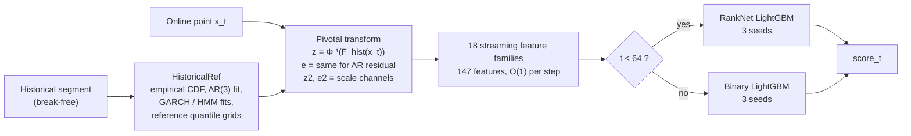

# Real-Time Structural Break Detection

My solution to the **ADIA Lab Structural Break Challenge: Real-Time Edition (2026)**, hosted on
[CrunchDAO](https://hub.crunchdao.com/competitions/structural-break-real-time).

A streaming feature engine of 18 statistical families (147 features) turns every incoming
observation into evidence that the series has changed. LightGBM models trained on that evidence
emit one break score per time step. Everything runs causally, in constant time per step, with
the same code path in training and inference.

**Highlights**

- **Pivotal features by construction.** Every online point is mapped through its own series'
  historical empirical CDF and then to a normal score, so under "no break" the features have the
  same distribution for every series. That is what makes scores comparable across series, which
  is exactly what the metric needs.
- **Statistics from the change-detection literature, implemented in streaming form.** Bayesian
  online change-point detection, GARCH-family volatility models, recursive residuals, hidden
  Markov models, kernel two-sample tests, L-moments, and a GRU null model trained with PyTorch
  and ported to NumPy for inference.
- **A custom pairwise ranking objective.** For the first 64 steps, a LightGBM model is trained on
  the metric's own comparisons: same-step pairs of a broken and a not-broken series, with a
  RankNet loss.
- **Statistically careful feature selection.** Univariate screening against a permutation null,
  then paired cross-validation with a strict adopt rule (more than 2 standard errors, and better
  on at least 5 of 6 fold-halves). The registry was cut from 42 families and 187 features to 17
  families and 82, then rebuilt to the current 18 families and 147 features one validated family at a time.
- **Production constraints taken seriously.** Train/serve parity checks, determinism checks
  matching the platform's 1e-8 tolerance, an inference time budget for 10,000 series, and
  compatibility with CrunchDAO's notebook-to-script converter.

---

## The problem

Each series has two parts:

- a **historical segment**, given up front, in which no break occurs;
- an **online segment** of 10 to 1,000 observations, revealed **one at a time**, in which a break
  may or may not happen, at an unknown step.

At every online step `t` the model must output a score for "a break has already happened",
using only the history and the online points up to `t`. There is no look-ahead.

**Metric: TS-AUC.** At each step `t`, the scores of all series are ranked against each other and
an AUC is computed (broken vs. not broken *so far*). The per-step AUCs are combined, weighted by
the number of positive/negative pairs at that step.

This creates a tension that drives the whole design. The metric compares **different series at
the same step**, but the model sees **one series at a time**. A raw statistic like "rolling
variance" means something different for a calm series and a volatile one, so its value can't be
ranked across series. The features have to be put on a common scale first.

## Approach



### 1. Pivotal transform

Each online value goes through the history's empirical CDF (probability integral transform) and
then the inverse normal CDF, giving `z_t`. If nothing has changed, `z_t ~ N(0, 1)` **whatever the
series' original distribution was**. The same is done for the residual of an AR(3) model fitted
on the history (`e_t`), which removes the serial dependence. Squared versions `z2` and `e2`
track scale. Every feature downstream is built on these channels, so a value of "2.5" means the
same thing on every series.

### 2. Streaming feature bank

Since the break time is unknown, each statistic is aggregated at several time scales at once:
expanding mean, EWMAs at three decay rates, trailing windows, and Page-CUSUM at three drifts.
This replaces an O(t) search over candidate break points with a fixed set of O(1) updates.

The features are organized as a **registry of families**. Each family is one self-contained class
that declares its feature names, does any one-off setup on the history, and updates from a shared
per-step state (ring buffers, running sums, memoized sorted windows). Adding a feature means
writing one class and registering it.

| Group | Families | What they measure |
|---|---|---|
| Scale banks | `z2`, `e2` | Scale of the value and of the AR residual, at every aggregation scale |
| Tails | `tail` | Rate of 2σ and 3σ exceedances, points outside the historical range |
| Time | `time` | `t` and `log t`. No signal within a step on its own; useful through interactions |
| Robust shape | `lmom` | L-scale, L-skewness and L-kurtosis against the history |
| Distribution distance | `wass`, `energy`, `mmd` | Wasserstein-1, energy distance, MMD with an RBF kernel, trailing window vs. history |
| Entropy | `entropy` | Vasicek spacing estimator of differential entropy |
| Bayesian change-point | `bocpd`, `dbocpd` | Online Bayesian filter for a variance break. `dbocpd` fits its hazard and break-size prior on the training set |
| Volatility models | `garch`, `argarch`, `tgarch` | GARCH(1,1) fitted on the history (on raw values, on AR residuals, and with Student-t innovations). Measures surprise relative to the *expected* volatility, so ordinary volatility clustering doesn't look like a break |
| History models | `recres`, `hmm` | Recursive least-squares residuals with CUSUM tests; a 2-state Gaussian HMM fitted by EM |
| Volatility series | `volser` | EWMA volatility series, calibrated against the same series on the history |
| Learned null model | `nullmodel` | A 2-layer GRU with a 5-component Gaussian mixture head, trained on break-free histories to predict the next value. Features are the surprise of each online point under it |

### 3. Models

- **Steps `t ≥ 64`: binary LightGBM.** The AUC-optimal score is any monotone transform of
  P(break has happened | data so far), so a well-calibrated classifier is the right target.
  Training rows are subsampled on a dense-early, sparse-late schedule and weighted by inverse
  sampling probability so the probabilities stay calibrated. Parameters come from an Optuna
  search, and three seeds are averaged. The final model is refit on all series with a tree count
  scaled from the early-stopped run.
- **Steps `t < 64`: pairwise ranker.** Early on, evidence is thin and calibration matters less
  than ordering. A LightGBM with a custom **RankNet objective** is trained directly on same-step
  (broken, not-broken) pairs, early-stopped on hold-out TS-AUC.
- **CatBoost and XGBoost blends** were tested extensively (`experiments/blend_test.py`,
  `experiments/blend_experiment.py`). The final model sets CatBoost's blend weight to 0, so the
  shipped score is LightGBM only.

### 4. Fitted-state families without leakage

`dbocpd` and `nullmodel` need parameters learned from training data. These are fitted inside
`train()` on the training split only. The GRU null model is **cross-fitted**: training series are
split into 3 groups and each group's features come from a model trained on the other two, so no
series is scored by a model that saw it. The network is trained in PyTorch in a separate
process, then evaluated in `infer()` by a float64 NumPy port that matches the PyTorch output to
about 1e-13.

## How decisions were made

Most candidate features did **not** make it into the final model. Every candidate was screened
in two stages.

1. **Univariate screen against a permutation null.** The folded TS-AUC `max(a, 1 - a)` of a
   useless feature is biased above 0.5, and rows from the same series aren't independent. So the
   noise floor is measured by permuting labels **at the series level**, not assumed.
2. **Paired cross-validation.** Baseline and candidate are trained on identical folds, and the
   decision uses the standard error of the per-fold *differences*. Adopt only if the mean gain is
   above 2 standard errors **and** the candidate wins on at least 5 of 6 fold-halves.

A per-family disk cache made this loop fast: adding a family extracts only that family's
columns, and the baseline's fold scores are cached, so a test takes minutes instead of hours.

**Examples of what was validated and kept**

| Change | Paired CV gain (TS-AUC) |
|---|---|
| `volser` family | +0.0028 |
| `nullmodel` family (GRU null model) | +0.0021 (3.1 standard errors) |
| `dbocpd` family (dataset-fitted priors) | +0.0009, better on 6 of 6 fold-halves |

**Examples of what was tested and rejected:** location tests (Welch t, Mann-Whitney),
dependence and trend tests (autocorrelation, Ljung-Box, Hurst exponent, slope), normality and
shape tests (Jarque-Bera, D'Agostino, Anderson-Darling), a block of history-context features, the
GJR-GARCH and wavelet-variance families, several redundant scale tests (F-test, Bartlett, Levene,
Siegel-Tukey), and a CatBoost blend. The rejected code is kept in
`feature_research/archived_families.py` and `archive/`.

On a 15% hold-out of the training series (1,531 series), the training logs show a hold-out
TS-AUC of about 0.62 for the RankNet LightGBMs.

## Engineering notes

- **Constant cost per step.** Ring buffers, running sums, incremental EWMA and CUSUM updates,
  and a per-step cache of sorted windows shared by all two-sample tests. Expensive families
  recompute on a stride that depends **only on `t`**, so every series is equally stale at a given
  step and the within-step ranking is unaffected.
- **Train/serve parity.** The model artifact records the exact feature families and fitted state
  it was trained with, and `infer()` rebuilds the extractor from the artifact. `tools/parity_blend.py`
  checks streaming inference against batch extraction to 1e-6.
- **Platform compatibility.** CrunchDAO converts the notebook to a script and comments out
  anything it considers non-essential. Module-level state is protected with
  `@crunch/keep` markers, and `tools/check_submission.py` converts the notebook, imports it in a
  fresh process, trains and streams on synthetic data, and checks determinism.
- **Parallel extraction that survives the platform runner.** The extraction backend falls back
  from loky to a fork pool to serial, because the platform's test runner breaks loky's worker
  start-up.
- **A library conflict, worked around.** PyTorch and LightGBM ship separate OpenMP runtimes that
  crash each other on macOS, so the GRU is trained in a separate interpreter and inference never
  runs PyTorch.
- **Refactoring with equivalence tests.** The notebook was restructured in six scripted phases,
  each tested against a frozen copy of the code it replaced (`archive/refactor_phases/`).

## Repository layout

```
├── submission.ipynb      The solution: feature engine, train(), infer(). This is what gets submitted.
├── research.ipynb        One-cell-per-idea research harness: tests a new family against the shipped bank
├── experiments/          Standalone CV experiments: Optuna tuning, blending, pruning, family screens
├── feature_research/     Candidate feature families, literature implementations, archived families
├── tools/                Submission checks: conversion, parity, determinism, inference profiling
├── archive/              Earlier notebook versions and superseded scripts (not needed to run anything)
└── requirements.txt
```

Each folder has its own README.

## Running it

```bash
python -m venv .venv && source .venv/bin/activate
pip install -r requirements.txt

# Link the notebook to the competition (get a token from your CrunchDAO account)
crunch setup structural-break-real-time <your-model-name> --token <YOUR_CRUNCH_TOKEN>
```

Then open `submission.ipynb` and run it top to bottom. It downloads the data, builds the feature
registry, and trains. `crunch_tools.test()` runs the full train-and-infer loop locally the way
the platform will.

The scripts in `experiments/` and `tools/` are run **from the repository root** and read the
feature cache (`cache/`) that the notebook builds. The cache, data and model artifacts are not
committed.

## References

The feature families draw on, among others:

- Adams & MacKay (2007), *Bayesian Online Changepoint Detection*
- Bollerslev (1986), GARCH; Glosten, Jagannathan & Runkle (1993), GJR-GARCH
- Brown, Durbin & Evans (1975), recursive residuals and CUSUM tests
- Hamilton (1989), regime-switching models
- Hosking (1990), L-moments
- Gretton et al. (2012), kernel two-sample test (MMD); Székely & Rizzo, energy distance
- Vasicek (1976), spacing estimator of entropy
- Page (1954), CUSUM
- Bandt & Pompe (2002), ordinal patterns; Moskvina & Zhigljavsky (2003), SSA change-point detection
- Vovk et al. (2021), conformal test martingales
